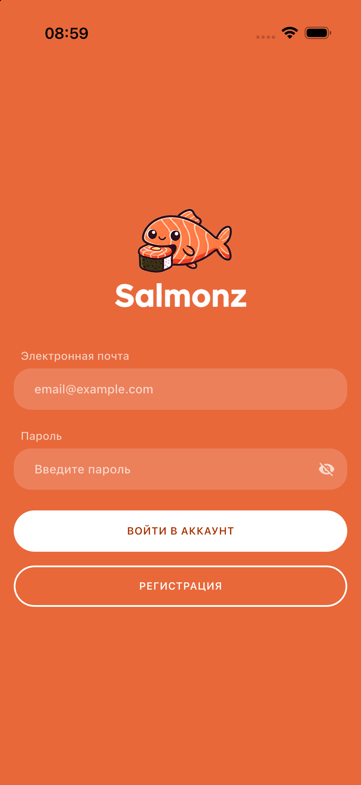
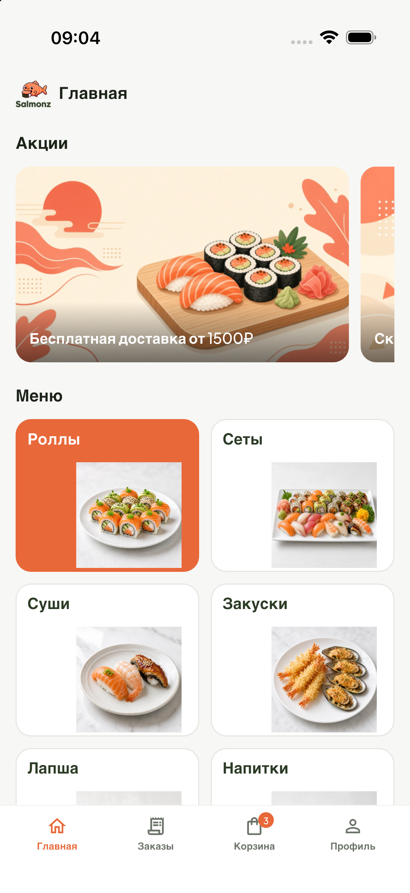
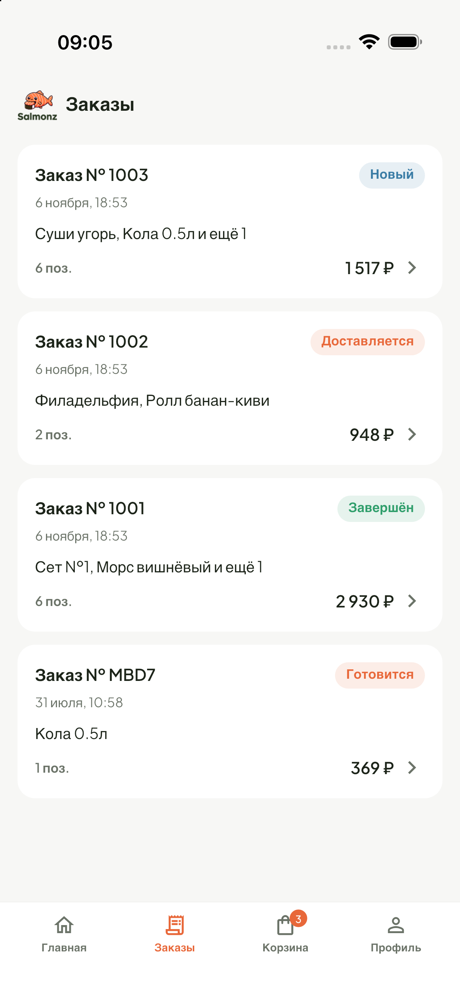
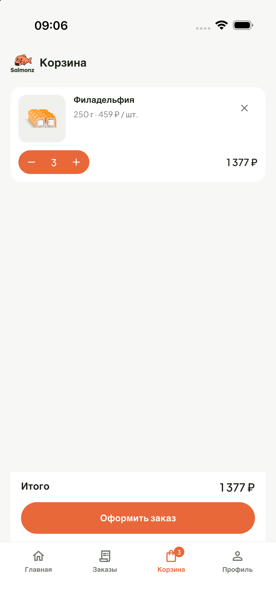
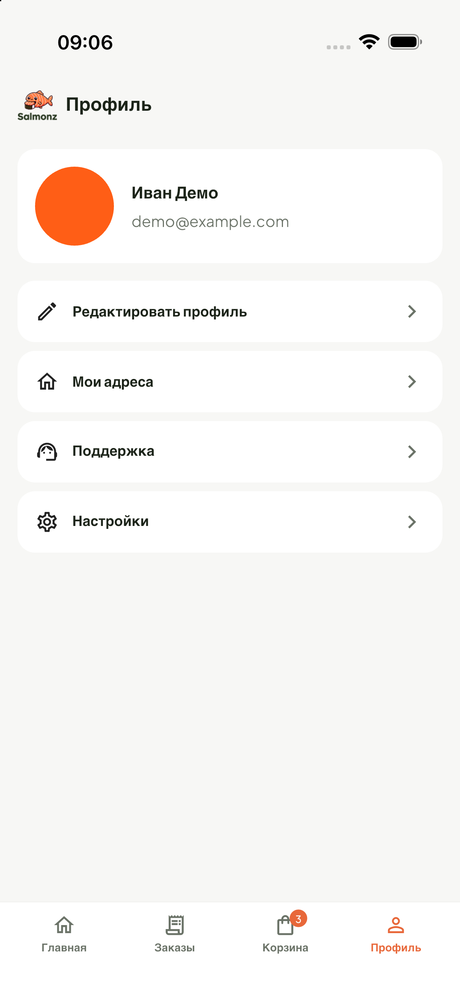
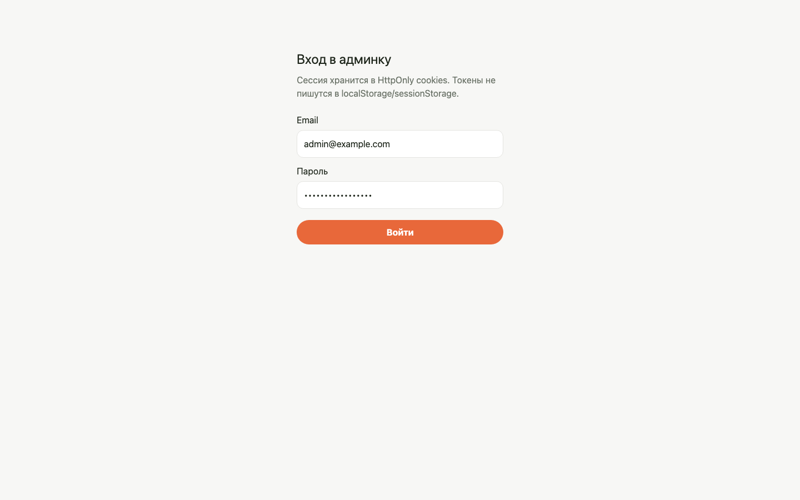
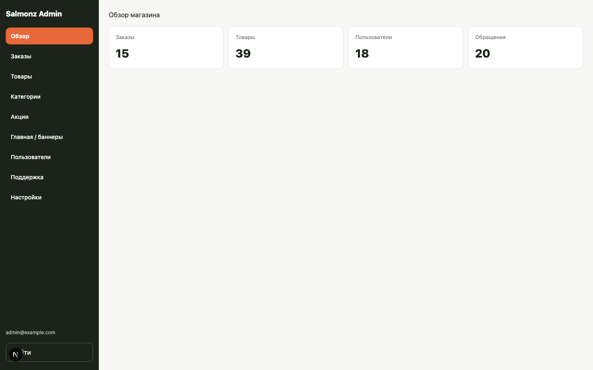
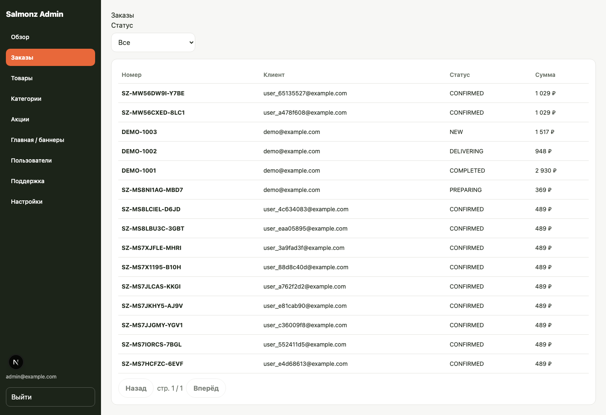
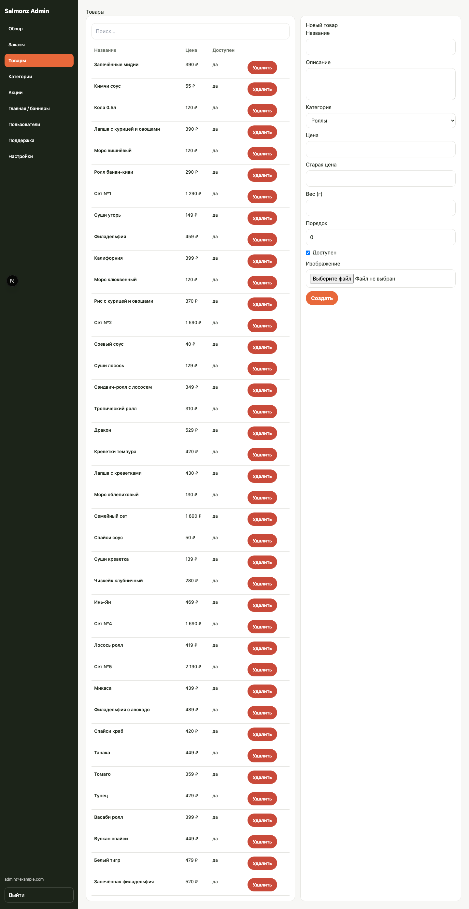

<p align="center">
  
</p>

# Salmonz

Локальный демонстрационный проект доставки суши и роллов для портфолио.

Клиент на Flutter, API на NestJS, админка на Next.js, PostgreSQL + Prisma, медиа через локальный storage или MinIO.

> Не production: без публичного хостинга, платежей и публикации в App Store / Google Play. Всё рассчитано на запуск у себя на машине.

<p align="center">
  
  
  
  
  
</p>

---

## Возможности покупателя

- Регистрация и вход (JWT)
- Каталог: 8 категорий, товары с фото, акции и баннеры
- Корзина и оформление заказа (server-side quote доставки)
- История заказов и статусы
- Адреса доставки, профиль, поддержка
- Светлая и тёмная тема, адаптив (телефон / iPad NavigationRail)

## Возможности админ-панели

- Вход только с ролью `ADMIN` (сессия в HttpOnly cookies)
- Обзор магазина
- Заказы со сменой статуса
- CRUD товаров, категорий, акций и баннеров
- Пользователи и обращения поддержки
- Загрузка изображений через BFF → Nest API

---

## Технологии

| Слой | Стек |
|------|------|
| Мобильный клиент | Flutter, Cubit/BLoC, Dio |
| API | NestJS, JWT, Swagger, Prisma |
| БД | PostgreSQL |
| Админка | Next.js (BFF), TypeScript |
| Медиа | локальный FS или S3-совместимое хранилище (MinIO) |
| Инфра | Docker Compose |

Документация: [ARCHITECTURE](docs/ARCHITECTURE.md) · [API](docs/API.md) · [LOCAL_DEVELOPMENT](docs/LOCAL_DEVELOPMENT.md) · [TESTING](docs/TESTING.md) · [SECURITY](SECURITY.md)

---

## Архитектура

```
Flutter (iOS / Android)              admin-web (Next.js BFF)
        │ REST /api/v1                         │
        └──────────────────┬───────────────────┘
                           ▼
                    NestJS + Swagger
                           │
                 ┌─────────┴─────────┐
            PostgreSQL          Storage (local / MinIO)
```

- **Flutter** — presentation + Cubit, репозитории к REST API.
- **NestJS** — доменные модули, Prisma, auth, заказы, каталог, media.
- **Next.js** — серверный BFF: CSRF, HttpOnly cookies, proxy к `/api/v1/admin/*`.

---

## Скриншоты

Сняты с локально запущенного Flutter (iOS Simulator) и admin-web.

| Вход | Главная | Заказы |
|:---:|:---:|:---:|
|  |  |  |

| Корзина | Профиль |
|:---:|:---:|
|  |  |

| Админ: вход | Админ: обзор |
|:---:|:---:|
|  |  |

| Админ: заказы | Админ: товары |
|:---:|:---:|
|  |  |

---

## Локальный запуск

Нужны: Flutter 3.9+, Node.js 20+, Docker, Git LFS.

### 1. Docker (PostgreSQL + MinIO) и backend

```bash
git lfs install && git lfs pull
cp docker-compose.example.env .env   # задайте JWT_* локально
docker compose up -d
cd backend
cp .env.example .env                 # при первом запуске
npm ci
npm run prisma:generate
npm run prisma:migrate:deploy
npm run start:dev
```

- API: http://127.0.0.1:3000/api/v1  
- Swagger: http://127.0.0.1:3000/docs  

### 2. Seed демо-данных

```bash
cd backend
npm run prisma:seed
```

Seed идемпотентный: повторный запуск безопасен. В `NODE_ENV=production` seed **не выполняется**.

### 3. Admin-web

```bash
cd admin-web
cp .env.example .env.local
npm ci
npm run dev
```

UI: http://127.0.0.1:3001

### 4. Flutter

```bash
cp config/local.example.json config/local.json
flutter pub get
flutter run
```

`config/local.json` указывает на `http://127.0.0.1:3000` (см. `config/local.example.json`).

---

## Demo-аккаунты

Создаются seed из переменных `backend/.env` (шаблон — `backend/.env.example`):

| Роль | Email | Пароль |
|------|-------|--------|
| Покупатель | `t@test.ru` | `12345678` |
| Администратор | `admin@example.com` | `ChangeMeAdmin123!` |

Только фиктивные данные для локальной БД. Секреты из приватного `.env` в README не копируются.

Если в своём `backend/.env` переопределены `DEMO_USER_*` / `ADMIN_*`, seed создаст именно их — смотрите вывод `npm run prisma:seed`.

---

## Тестовые данные после seed

- 8 категорий меню
- 39 товаров с подходящими фотографиями
- Акции и баннеры
- Адреса демо-покупателя
- Примеры заказов в разных статусах
- История переписки поддержки

Медиа отдаются через backend / MinIO; в клиенте и админке отображаются `imageUrl` из API.

---

## Команды проверки

Локальный gate перед push (тесты не отключаются):

```bash
./scripts/check-before-push.sh
```

По частям:

```bash
flutter analyze
flutter test
flutter build apk --debug \
  --dart-define=API_BASE_URL=http://127.0.0.1:3000 \
  --dart-define=APP_ENV=ci \
  --dart-define=APP_DEMO=true

cd backend && npm test && npm run lint && npm run build
# при живом API + DATABASE_URL:
cd backend && RUN_E2E=1 npm run test:e2e

cd admin-web && npm run lint && npm run build
# при живых API (:3000) и admin-web (:3001):
cd admin-web && ADMIN_WEB_URL=http://127.0.0.1:3001 npm run test:smoke
```

CI на GitHub Actions в этом репозитории не используется: проверки — локально через `scripts/check-before-push.sh`.

---

## Ограничения демонстрационного проекта

- Нет реального эквайринга и push-уведомлений
- Нет продакшен-деплоя и магазинных сборок
- Seed и demo-логины только для локальной разработки
- Изображения каталога — демонстрационные ассеты (не коммерческий сток под прод)
- Портфолио-демо: поведение API и UI могут упрощаться относительно боевого сервиса

---

## Лицензия

MIT — [LICENSE](LICENSE).
